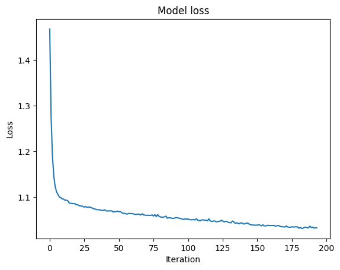

# Speech Emotion Recognition on IEMOCAP

Classifying the emotion of spoken utterances (**angry, happy, excited, sad, neutral**) from the
[IEMOCAP](https://sail.usc.edu/iemocap/) corpus, using two independent signals:

- **Audio:** a multi-layer perceptron trained on openSMILE acoustic features.
- **Text:** a multinomial Naive Bayes classifier written from scratch in NumPy, trained on utterance transcripts.

Both models beat a chance-level baseline by more than 2.5×, and the code is laid out so that
either model can be swapped out or extended.

## Architecture

```
                    ┌──────────────────────────┐
data/IEMOCAP_       │ ser.data.load_features   │──► audio_dataset() ──► MLPClassifier (300 hidden)  ─► ser.train_audio
features.pkl  ────► │  (dialogue-level dump)   │──► utterances_dataframe() ──────────────────────► ser.explore
                    └──────────────────────────┘
data/iemocap_       ┌──────────────────────────┐
text.csv      ────► │ ser.data.load_text_csv   │──► CountVectorizer ──► NaiveBayesClassifier ─────► ser.train_text
                    └──────────────────────────┘                       (ser/naive_bayes.py)
```

| Module | Responsibility |
|---|---|
| `ser/config.py` | Paths and the label → emotion mapping (label 5, *frustrated*, is excluded) |
| `ser/data.py` | Loads the feature pickle and the transcript CSV; builds model-ready arrays |
| `ser/naive_bayes.py` | Multinomial NB with Laplace smoothing; works on sparse or dense counts |
| `ser/train_audio.py` | Dummy baseline, MLP training, classification report, loss-curve plot |
| `ser/train_text.py` | Bag-of-words features, NB training and evaluation |
| `ser/explore.py` | Flattens the dataset into a per-utterance DataFrame and summarises it |

## Results

All scores are on a held-out random split (fixed seeds, so runs are reproducible).

| Model | Input | Test samples | Accuracy | Macro F1 |
|---|---|---|---|---|
| Stratified dummy baseline | openSMILE audio features (100-d) | 1,086 | 22.1% | n/a |
| **MLP** (1×300, adaptive LR) | openSMILE audio features (100-d) | 1,086 | **55.9%** | 0.488 |
| **Naive Bayes** (from scratch) | Augmented transcript, bag of words | 1,107 | **53.0%** | 0.487 |
| Naive Bayes (from scratch) | Original transcript, bag of words | 1,107 | 55.9% | n/a |

- The audio model is strongest on *sad* (F1 0.68) and *angry* (F1 0.66). *Happy* is the hardest class
  for both models because it has the fewest samples and is often confused with *excited*.
- The from-scratch Naive Bayes gives exactly the same predictions as scikit-learn's `MultinomialNB(alpha=1)`.



**Limitations:** the audio experiment samples train and test utterances from the same dialogues
(the official training dialogues only). Speakers are shared across the split, so the scores are
optimistic compared with a speaker-independent evaluation.

## Data

The datasets are **not included** in this repository: IEMOCAP's licence does not allow
redistribution. To get them:

1. Request access to IEMOCAP from USC SAIL: <https://sail.usc.edu/iemocap/> (you must sign a release form).
2. **Audio features:** download `IEMOCAP_features.pkl`, the pre-extracted feature dump (openSMILE audio,
   TextCNN text and 3D-CNN visual features, plus the official train/test dialogue split) distributed with
   DialogueRNN in [declare-lab/conv-emotion](https://github.com/declare-lab/conv-emotion).
3. **Transcripts:** `iemocap_text.csv` has one row per utterance, with the columns
   `FileName, Sentences, Label, text, AugmentedText`. It is built from the IEMOCAP transcripts and
   emotion labels (`neu, ang, sad, exc, hap`). `AugmentedText` holds a paraphrased version of each sentence.

Put both files in `data/`:

```
data/
├── IEMOCAP_features.pkl
└── iemocap_text.csv
```

## Usage

```bash
python -m venv .venv && source .venv/bin/activate
pip install -r requirements.txt

python -m ser.explore                              # inspect the dataset
python -m ser.train_audio                          # MLP on audio features; saves visualizations/model_loss.png
python -m ser.train_text                           # Naive Bayes on augmented transcripts
python -m ser.train_text --column Sentences        # ...or on the original transcripts
```

Every script accepts `--help`. Use `--seed` and `--test-size` to change the split. `train_audio` also
accepts `--show` (open the loss plot in a window) and `--no-plot`.
